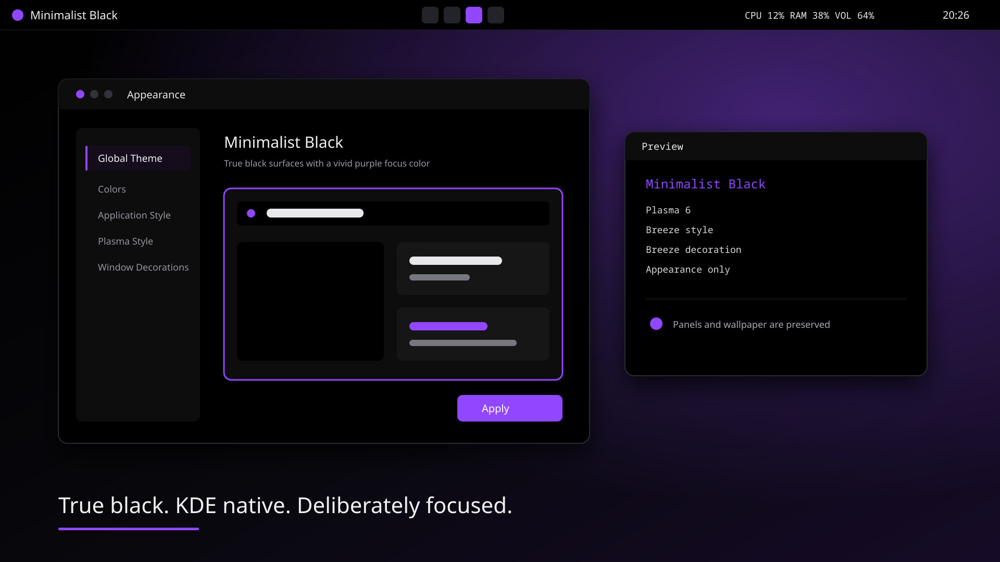

# Minimalist Black for KDE Plasma 6

Minimalist Black for KDE Plasma 6, shipped in two deliberately different
editions.



| Edition | Delivery | Changes | Safety model |
| --- | --- | --- | --- |
| **KDE Store** | Native `Plasma/LookAndFeel` package | Embedded black color scheme, Breeze widget style, Plasma Style, and window decoration | No layout, wallpaper, custom widget, script, display, or shortcut changes |
| **GitHub Extended** | Reviewed shell workflow | Store appearance plus Konsole, Fastfetch, two project Plasmoids, and a guarded one-panel layout | Read-only diagnosis, complete plan, exact-path snapshot, explicit apply, verification, and rollback |

Version `1.0.0` is a release candidate. The package and source archives can be
built and tested locally, and the verified clean-history source may be
published as an untagged public RC. A tagged v1.0.0 release, downloadable
release artifacts, and KDE Store publication remain blocked until the native
Fedora and Arch-family acceptance checklist in [Release](docs/RELEASE.md)
passes.

## KDE Store edition

The Store package is self-contained and intentionally small. Applying it sets:

- the embedded `KdeRiceStoreBlack` color scheme;
- Breeze application style;
- Breeze Plasma Style;
- Breeze window decoration.

It does **not** contain `contents/layouts`, so Plasma's “use desktop layout from
theme” path cannot replace the user's panel. It also contains no wallpaper,
icons, cursor, fonts, splash screen, Konsole profile, Fastfetch config, custom
Plasmoid, executable, or install hook.

The package source is
[`packages/store/io.github.badwordsno.minimalistblack`](packages/store/io.github.badwordsno.minimalistblack).
Build the exact KDE Store archive with:

```bash
scripts/build-store-release --output dist
```

Installing a package does not apply it. Applying or reverting a Global Theme is
a live desktop change and is left to System Settings. Revert to the previous
installed Global Theme (or Breeze if it is unavailable) before uninstalling
Minimalist Black. A Global Theme can restore only the components it owns; exact
pre-change restoration is an Extended-edition feature.

## GitHub Extended edition

Extended adds the compact top panel, native CPU/RAM/GPU/VOL readout, active
window title, Konsole profile, and privacy-safe Fastfetch presentation. Pinned
launchers remain user-owned. The current wallpaper is also user-owned and is
preserved. An already exact Pager or Workspaces final variant is likewise
preserved and verified rather than removed.

The `minimalist-v04` / `v0.4.1` strings retained by the scripts identify the
panel-topology contract and migration lineage. The distributable product
version is the root `VERSION` value (`1.0.0`).

Clone the public source, then run the normal workflow from the target user's
Plasma 6 Wayland session:

```bash
git clone https://github.com/badwordsno/minimalist-black-kde.git
cd minimalist-black-kde
scripts/doctor --target minimalist-v04
scripts/bootstrap
# Review the complete plan and rollback command before the live action:
scripts/bootstrap --apply
scripts/verify --panel-target minimalist-v04
```

Plain `scripts/bootstrap` is always a dry run. Before its first live write,
`--apply` snapshots every path in
[`config/managed-paths.txt`](config/managed-paths.txt). An unsupported
environment or unknown panel topology is refused. A documented degraded path
requires the separate `--allow-degraded` acknowledgement, and it cannot
override a missing required capability or unknown topology.

Restore is preview-first:

```bash
scripts/restore --backup /absolute/path/to/snapshot
scripts/restore --backup /absolute/path/to/snapshot --apply
```

Existing targets are moved into recoverable displaced state rather than
deleted. Plasma and KWin are never restarted automatically. Resolution, scale,
output placement, refresh rate, HDR, VRR, shortcuts, and unrelated user files
remain outside the managed boundary.

Build the clean public source archive with:

```bash
scripts/build-extended-release --output dist
```

To produce both versioned artifacts plus one verified checksum manifest in a
single step, run `scripts/build-release --output dist`.

The Extended builder copies only the exact public allowlist, normalizes archive
metadata, and rejects symlinks, traversal, private payload hashes, or archival
material. A public GitHub repository must begin from that verified archive as a
new history. Do not change this recovery checkout's visibility: its historical
objects are intentionally outside the public release boundary.

## Compatibility

Compatibility is capability-based rather than distribution-name-based.

- Store metadata targets Plasma 6.0 or newer and uses only native Breeze and
  embedded LookAndFeel facilities. Native release acceptance is still required
  on Fedora and an Arch-family system.
- Extended's live-confirmed panel contract is Plasma/KWin 6.7.x on a Plasma
  Wayland session with one known base, Pager, or Workspaces final panel.
  Other Plasma 6 minors are degraded until observed; Plasma 5 and future major
  versions are unsupported.
- Multiple monitors with one panel are degraded. Per-monitor panels and unknown
  panel layouts are refused rather than normalized.
- The optional GPU row and live volume backend depend on capabilities detected
  by `scripts/doctor`.

The historical Arch-family validation was performed on EndeavourOS, not a
separate plain-Arch installation. Fedora 44 and that EndeavourOS lineage are the
two native acceptance lanes for this release candidate. See
[Compatibility](docs/COMPATIBILITY.md) for the evidence boundary.

## Tests and release boundary

```bash
set -e
for test_script in tests/test-*.sh; do
  bash "$test_script"
done
find scripts tests -type f -print0 |
  while IFS= read -r -d '' shell_file; do
    bash -n "$shell_file"
  done
git diff --check
```

Qt 6 `qmllint` is a release-test dependency, not an Extended runtime
dependency. Missing it leaves the complete repository gate blocked; this
project never installs it automatically. Tests use temporary homes and mocked
Plasma interfaces and must never target the real desktop.

The maintainer's separate private recovery checkout contains archival artwork
with unresolved redistribution rights. It is not included in this public
source or either public artifact, and is not covered by the MIT license. See
[Licensing boundary](LICENSES.md),
[Editions](docs/EDITIONS.md), [Testing](docs/TESTING.md), and
[Release](docs/RELEASE.md).
