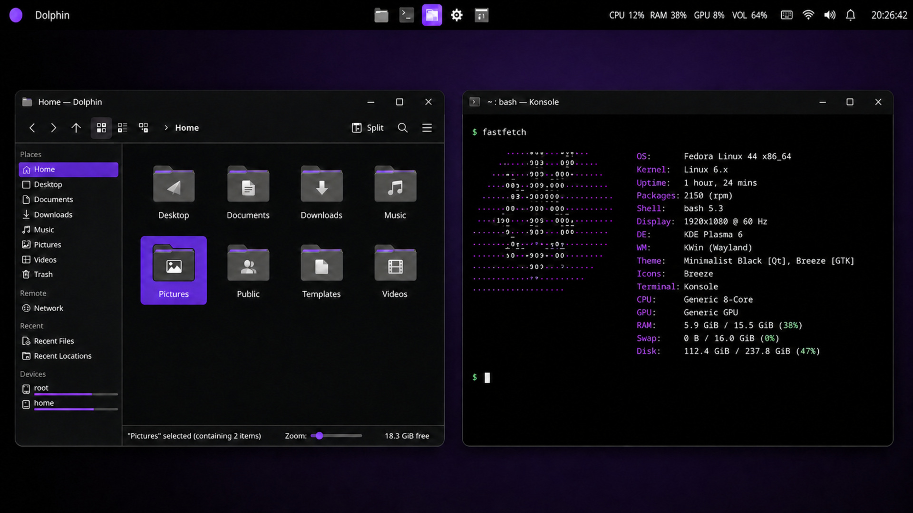

# Minimalist Black for KDE Plasma 6

Minimalist Black configures a black/Breeze KDE desktop with a compact native
Plasma panel, three project widgets, Konsole, and Fastfetch. It ships as one
public source archive with a guarded apply and recovery workflow.



This illustrative view shows the panel, Dolphin, Konsole, and Fastfetch together.
The depicted wallpaper is user-owned and is not distributed or managed.
The illustration uses the earlier purple accent; the current source palette
uses blue `#007ACC`.

Version `1.0.0` remains a release candidate. Automated checks and a verified
public source archive do not replace the Fedora and Arch-family native
acceptance checklist in [Release](docs/RELEASE.md).

## Desktop components

Minimalist Black ships and installs three project Plasmoid packages. Active Window
Title and Resource Usage are present on the base panel; Workspaces supports the
optional project-owned Workspaces final variant. The alternative Pager variant
uses Plasma's built-in Pager, not a fourth project package. Bootstrap adds
neither optional switcher to the base target. If an exact Pager or Workspaces
final variant is already active, it preserves and verifies that exact variant.
Pinned launchers and the current wallpaper remain user-owned and are preserved.

### Chimera widget layer

The three project widgets now share one generated, package-local Chimera QML
grammar: a 2 px grid, square raised/sunken edges, one accent state rail, and a
separate keyboard-focus outline. Each package remains self-contained while the
release gate rejects drift from the canonical source in
[design/chimera](design/chimera/README.md).

Their normal Plasma configuration dialogs expose title templates, icon and
width policy, guarded window controls, metric order/visibility/update rate and
thresholds, workspace labels, single-desktop visibility, and wheel wrapping or
inversion. Widget refresh and failure recovery preserve those user-owned keys.
The private volume backend is isolated behind a Loader so its absence disables
only VOL rather than the complete resource strip.

No external theme or Plasmoid source is copied into this layer. The reviewed
upstream commits, file-level license decisions, and planned MIT/GPL boundaries
are recorded in [the Chimera component catalog](research/chimera-components.json)
and [third-party notices](THIRD_PARTY_NOTICES.md).

The `minimalist-v04` / `v0.4.1` strings retained by the scripts identify the
panel-topology contract and migration lineage. The distributable product
version is the root `VERSION` value (`1.0.0`).

## Normal workflow

Use `doctor`, `bootstrap`, `verify`, and `restore` as the normal entry points.
Versioned apply commands are migration components; see
[Architecture](docs/ARCHITECTURE.md) for their roles.

Clone the public source, then run the normal workflow from the target user's
Plasma 6 Wayland session:

```bash
git clone https://github.com/badwordsno/kde-rice.git
cd kde-rice
scripts/doctor --target minimalist-v04
scripts/bootstrap
# Review the complete plan and rollback command before the live action:
scripts/bootstrap --apply
scripts/verify --panel-target minimalist-v04
```

The final command shows the base target. If bootstrap preserves an exact Pager
or Workspaces final variant, use the exact `minimalist-v04-pager` or
`minimalist-v04-workspaces` target printed by its plan and receipt.

Plain `scripts/bootstrap` is always a dry run. Before its first live write,
`--apply` snapshots every path in
[`config/managed-paths.txt`](config/managed-paths.txt). An unsupported
environment or unknown panel topology is refused. A documented degraded path
requires the separate `--allow-degraded` acknowledgement, and it cannot
override a missing required capability or unknown topology.

Restore replaces complete managed files, including any settings changed in
those files after the snapshot. Review its preview before applying:

```bash
scripts/restore --backup /absolute/path/to/snapshot
scripts/restore --backup /absolute/path/to/snapshot --apply
```

New snapshots use format 2 with a SHA-256 content checksum covering the payload
and its path/type manifests. Restore checks it before displacing any file,
then compares restored contents with the baseline before reporting success.
Format-1 snapshots remain readable with an explicit integrity warning.
Snapshot and restore enforce the same canonical XDG roots as bootstrap.
Mutating commands share a nonblocking `flock` on the existing home directory;
nested components inherit it, and a second operation is refused without writes.

Existing targets are moved into recoverable displaced state rather than
deleted. Plasma and KWin are never restarted automatically. Resolution, scale,
output placement, refresh rate, HDR, VRR, shortcuts, and unrelated user files
remain outside the managed boundary.

## Build

Build the clean public source archive with:

```bash
scripts/build-release --output dist
```

This creates `minimalist-black-kde-<version>.tar.xz`, its checksum sidecar,
and `SHA256SUMS`. `scripts/build-source-release` is the internal source builder.

The source builder copies only the exact public allowlist, normalizes archive
metadata, and rejects symlinks, traversal, private payload hashes, or archival
material. A public GitHub repository must begin from that verified archive as a
new history. Do not change this recovery checkout's visibility: its historical
objects are intentionally outside the public release boundary.

## Compatibility

Compatibility is capability-based rather than distribution-name-based.

- The workflow's live-confirmed panel contract is Plasma/KWin 6.7.x on a Plasma
  Wayland session with one known base, Pager, or Workspaces final panel.
  Other Plasma 6 minors are degraded until observed; Plasma 5 and future major
  versions are unsupported.
- Multiple monitors with one panel are degraded. Per-monitor panels and unknown
  panel layouts are refused rather than normalized.
- The optional GPU row and live volume backend depend on capabilities detected
  by `scripts/doctor`.

The historical Arch-family validation was performed on EndeavourOS, not a
separate plain-Arch installation. Fedora 44 and that EndeavourOS lineage are the
two native acceptance lanes for this release candidate. See
[Compatibility](docs/COMPATIBILITY.md) for the evidence boundary.

## Tests and release boundary

Run `scripts/check-release` for the automated gate: candidate tests and syntax,
the offscreen readability check, two matching release builds with checksum
verification, and tests and syntax
from the extracted public source. Logs and local artifacts remain in its
printed temporary directory. This command does not apply a theme, install
prerequisites, or publish artifacts; native acceptance remains separate.


```bash
set -e
for test_script in tests/test-*.sh; do
  bash "$test_script"
done
python3 tests/test-panel-readability.py
for shell_file in scripts/* scripts/lib/*.sh tests/*.sh tests/lib/*.sh; do
  [[ -f "$shell_file" ]] || continue
  bash -n "$shell_file"
done
git diff --check
```

Qt 6 `qmllint` is a release-test dependency, not a desktop runtime
dependency. Missing it leaves the complete repository gate blocked; this
project never installs it automatically. Tests use temporary homes and mocked
Plasma interfaces and must never target the real desktop. Missing visual-test
dependencies are reported as `NOT RUN` and leave `check-release` incomplete
(exit 77), rather than producing a full pass.

The maintainer's separate private recovery checkout contains archival artwork
with unresolved redistribution rights. It is not included in this public
source or the public artifact, and is not covered by the MIT license. See
[Licensing boundary](LICENSES.md),
[Scope](docs/SCOPE.md), [Testing](docs/TESTING.md), and
[Release](docs/RELEASE.md).
